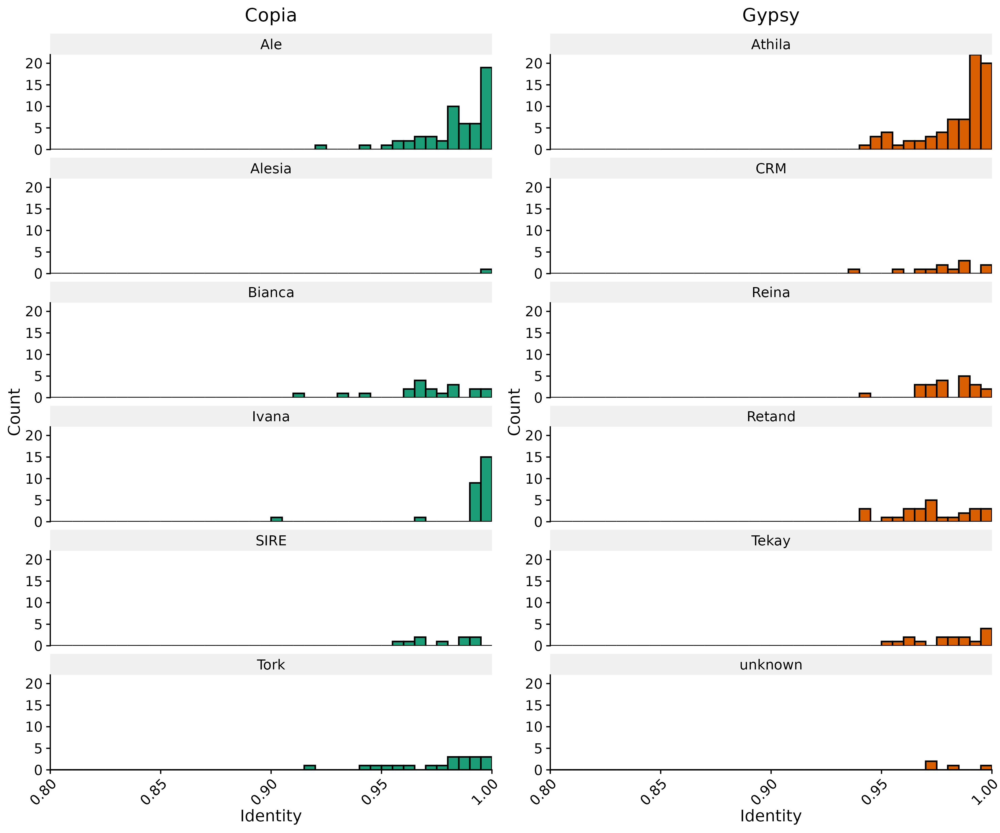
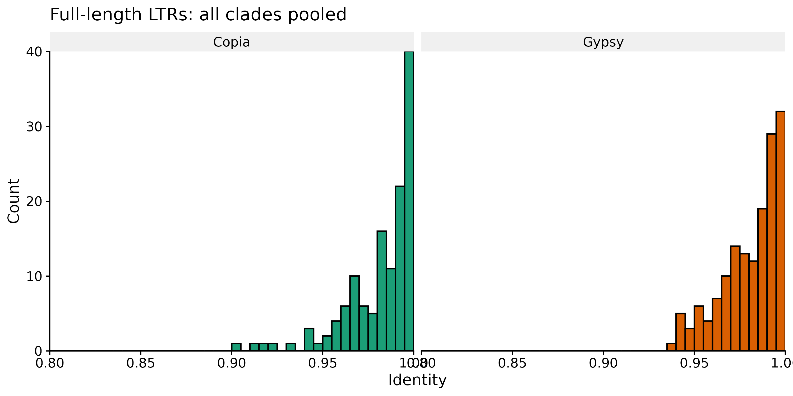
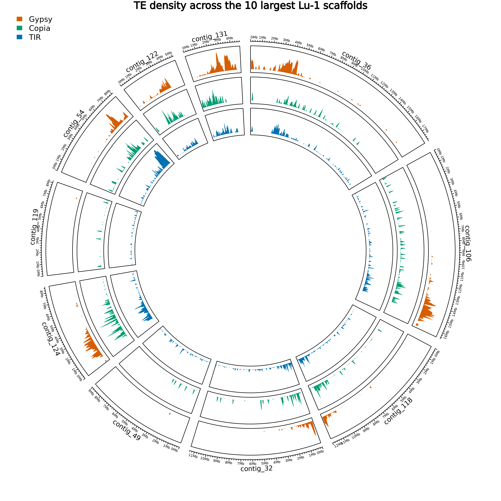
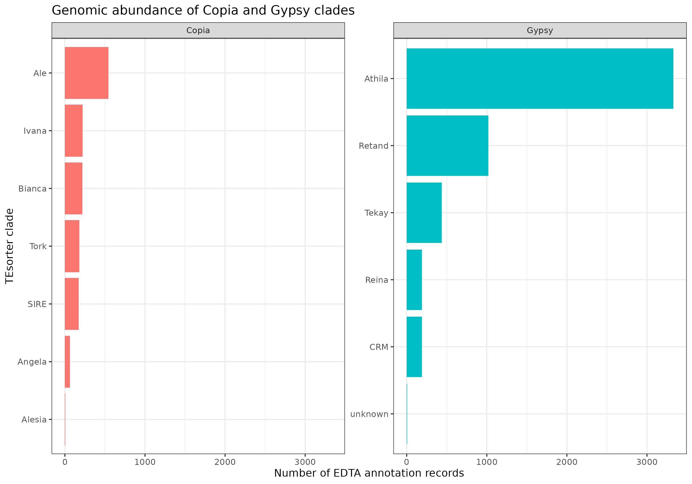
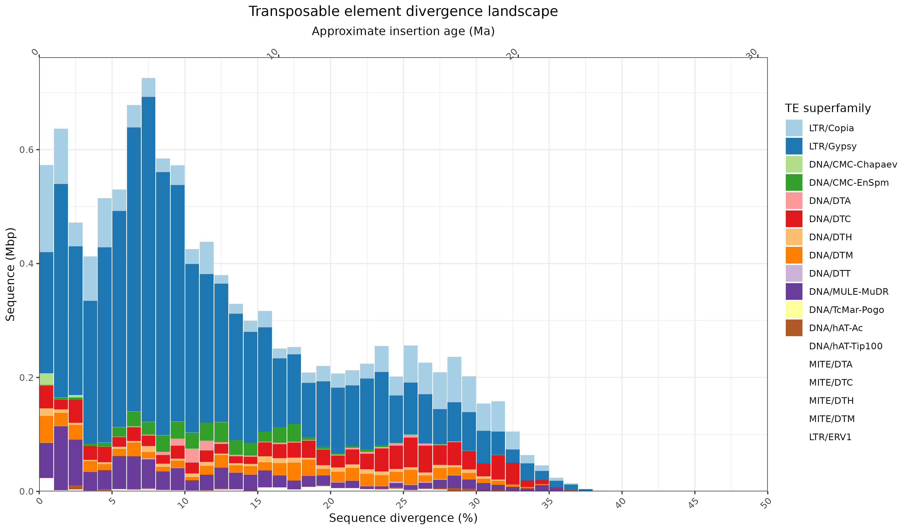

# Organization and Annotation of Eukaryote Genomes

Scripts, selected results and notes from the MSc course.

## Repository structure

- `scripts/` — analysis scripts
- `plots/` — selected figures
- `data/` — local input data and links to course files
- `results/` — analysis outputs
- `logs/` — Slurm output and error logs

## Week 1 — Transposable Element Annotation and Classification

### Genome assembly

The Flye assembly of the Lu-1 accession was used for transposable element annotation.

- Assembly size: **138,067,759 bp**
- Number of sequences: **99**
- TE annotation performed with **EDTA**
- Full-length LTR retrotransposons further classified with **TEsorter / REXdb-plant**

### EDTA annotation summary

EDTA annotated a total of **19,850,279 bp** as repetitive sequence, corresponding to **14.38% of the genome**.

| TE class / superfamily | Count | bp masked | Genome masked |
|---|---:|---:|---:|
| Gypsy | 5,232 | 7,076,529 | 5.13% |
| Helitron | 8,813 | 5,100,757 | 3.69% |
| Mutator | 2,488 | 1,799,501 | 1.30% |
| Copia | 1,557 | 1,754,341 | 1.27% |
| CACTA | 3,166 | 1,612,430 | 1.17% |
| Repeat fragments | 2,774 | 815,010 | 0.59% |
| L1 | 1,012 | 610,244 | 0.44% |
| LTR unknown | 715 | 449,893 | 0.33% |
| PIF/Harbinger | 722 | 297,560 | 0.22% |
| hAT | 419 | 195,365 | 0.14% |
| Tc1/Mariner | 55 | 69,590 | 0.05% |
| Jockey | 85 | 30,543 | 0.02% |
| Endogenous retrovirus | 40 | 28,981 | 0.02% |
| L2 | 18 | 8,591 | 0.01% |

**Main observation:** Gypsy elements occupy the largest fraction of the genome (**5.13%**), while Helitrons have the highest number of annotated copies (**8,813**).

The total number of interspersed repeat annotations was **27,099**, covering **14.38%** of the assembly.

### Full-length LTR classification

Full-length LTR retrotransposons identified by EDTA were classified with TEsorter using the `rexdb-plant` database.

The LTR identity distributions are strongly shifted toward high sequence identity, particularly around **0.95–1.00**, suggesting that many intact LTR elements represent relatively recent insertions. A smaller number of elements show identities around **0.80–0.90**, consistent with comparatively older insertions.

Different Copia and Gypsy clades show distinct identity distributions. Examples include strong high-identity signals in the Copia **Ale** and **Ivana** clades and the Gypsy **Athila** clade.

### Full-length LTR identity distributions

The identity distributions of full-length LTR retrotransposons are strongly shifted toward high identity values, particularly between 0.95 and 1.00. This suggests that many intact LTR elements represent relatively recent insertions.

#### Copia and Gypsy clade-level distributions

Different clades show distinct identity distributions. Strong high-identity signals are visible, for example, for the Copia Ale and Ivana clades and the Gypsy Athila clade.

#### Global Copia versus Gypsy distribution

Both Copia and Gypsy show a strong enrichment toward high LTR identity, while a smaller number of elements occur at lower identity values, consistent with comparatively older insertions.

### Workflow scripts

- `scripts/Week01_Script01_run_EDTA.sh` — EDTA genome-wide TE annotation
- `scripts/Week01_Script02_run_TEsorter_full_length_LTRs.sh` — classification of intact LTR retrotransposons
- `scripts/Week01_Script03_full_length_LTR_identity.R` — analysis and visualization of LTR identity
- `scripts/Week01_Script03_run_full_length_LTR_identity.sh` — Slurm wrapper for the R analysis

## Week 2 — TE Distribution, Classification and Dynamics

### Genome-wide TE distribution

The genomic distribution of the major TE groups was investigated using the final EDTA `TEanno.gff3` annotation. Gypsy, Copia and TIR transposons were visualized across the ten largest scaffolds using 100 kb density windows.

The three TE groups show clearly distinct genomic distributions rather than uniform accumulation across the assembly.

Notable examples include:

- `contig_131` shows the highest Gypsy density among the ten largest scaffolds, with approximately **146.3 Gypsy elements/Mb**. It also has the highest Copia density at approximately **30.7 elements/Mb**.
- `contig_54` is strongly enriched in TIR transposons, with approximately **236.8 elements/Mb**.
- `contig_124` is comparatively TE-rich across all three groups, with approximately **71.6 Gypsy**, **70.2 TIR** and **19.7 Copia elements/Mb**.
- `contig_49` and `contig_119` contain relatively few Gypsy and Copia annotations.

These results indicate substantial regional differences in TE composition across the assembly.

### Library-level Copia and Gypsy classification

To refine the classification of LTR retrotransposons beyond the intact elements analysed in Week 1, all Copia and Gypsy sequences were extracted from the complete EDTA TE library and classified with **TEsorter using REXdb-plant**.

A total of:

- **102 Copia** library sequences were extracted, of which **90** received a TEsorter classification.
- **91 Gypsy** library sequences were extracted, of which **69** received a TEsorter classification.

The TEsorter classifications were then matched back to the EDTA library identifiers in the genome-wide `TEanno.gff3` annotation to estimate the genomic abundance of each clade.

### Copia and Gypsy clade abundance

#### Copia

| Clade | Annotation count | Library families | Annotated bp |
|---|---:|---:|---:|
| Ale | 542 | 46 | 693,498 |
| Ivana | 221 | 12 | 291,018 |
| Bianca | 219 | 6 | 258,598 |
| Tork | 179 | 17 | 254,369 |
| SIRE | 171 | 5 | 179,408 |
| Angela | 63 | 1 | 28,948 |
| Alesia | 6 | 1 | 6,566 |

The most abundant Copia clade is **Ale**, with **542 genome-wide annotations**.

#### Gypsy

| Clade | Annotation count | Library families | Annotated bp |
|---|---:|---:|---:|
| Athila | 3,330 | 21 | 5,061,703 |
| Retand | 1,019 | 14 | 1,223,183 |
| Tekay | 437 | 6 | 563,612 |
| Reina | 191 | 15 | 312,855 |
| CRM | 189 | 10 | 229,056 |
| unknown | 6 | 2 | 3,606 |

The Gypsy landscape is strongly dominated by **Athila**, with **3,330 annotations** and more than **5 Mb** of annotated sequence. **Retand** is the second most abundant Gypsy clade.

The strong contribution of Ale and Athila is also consistent with their prominent signals in the full-length LTR analysis from Week 1.

### TE divergence landscape

TE amplification history was investigated using RepeatMasker divergence values. Exact 0% divergence matches were removed before parsing because they may represent library sequences matching themselves.

The detailed RepeatMasker output contained **38,224 records**, which was reduced to **36,682 records** after removal of zero-divergence matches.

TE abundance was summarized in 1% divergence bins and expressed in **Mbp rather than element counts**, reducing the influence of highly fragmented TE annotations.

The divergence landscape shows different amplification histories among TE superfamilies.

The largest overall contribution is from **LTR/Gypsy**, representing approximately **6.74 Mb** in the analysed landscape, followed by **LTR/Copia** with approximately **1.51 Mb**.

### Approximate insertion-age estimation

Approximate insertion ages were calculated from sequence divergence using:

**T = K / (2r)**

where:

- `K` is sequence divergence,
- `r = 8.22 × 10^-9 substitutions/site/year`,
- `T` is the approximate time since insertion.

Under this substitution rate, **1% divergence corresponds to approximately 0.61 million years**.

Selected divergence peaks were:

| TE superfamily | Peak divergence | Approximate peak age |
|---|---:|---:|
| LTR/Gypsy | 7.5% | 4.56 Ma |
| LTR/Copia | 0.5% | 0.30 Ma |
| DNA/MULE-MuDR | 1.5% | 0.91 Ma |
| DNA/DTM | 0.5% | 0.30 Ma |
| DNA/CMC-EnSpm | 12.5% | 7.60 Ma |
| DNA/DTC | 25.5% | 15.51 Ma |

The very low-divergence Copia peak suggests a comparatively recent Copia amplification signal, whereas the dominant Gypsy peak occurs at higher divergence and therefore corresponds to an older major amplification signal.

These values should be interpreted as **approximate divergence-based age estimates rather than exact insertion dates**, because they depend directly on the assumed substitution rate and on sequence divergence from the representative EDTA library sequence.

### Week 2 result files

Selected quantitative results are stored in `results/TE_annotation/`, including:

- `Week02_TE_density_top10_scaffolds.tsv` — TE counts and densities across the ten largest scaffolds
- `Week02_Copia_Gypsy_clade_abundance.tsv` — genome-wide Copia and Gypsy clade abundance
- `Week02_Copia_Gypsy_matched_annotations.tsv` — EDTA annotations matched to TEsorter classifications
- `Week02_TE_divergence_landscape.tsv` — divergence landscape values
- `Week02_TE_landscape_peak_summary.tsv` — peak divergence and approximate age estimates

### Workflow scripts

- `scripts/Week02_Script01_TE_density_circos.R` — genome-wide Gypsy, Copia and TIR density analysis
- `scripts/Week02_Script01_run_TE_density_circos.sh` — Slurm wrapper for TE density analysis
- `scripts/Week02_Script02_run_TEsorter_library.sh` — library-level Copia and Gypsy classification with TEsorter
- `scripts/Week02_Script03_clade_abundance.R` — matching TEsorter clades to EDTA annotations and estimating genomic abundance
- `scripts/Week02_Script03_run_clade_abundance.sh` — Slurm wrapper for clade-abundance analysis
- `scripts/Week02_Script04_prepare_TE_dynamics.sh` — initial RepeatMasker divergence parsing
- `scripts/Week02_Script05_prepare_detailed_TE_landscape.sh` — preparation of detailed RepeatMasker superfamily-level landscape data
- `scripts/Week02_Script06_TE_landscape.R` — TE divergence landscape and approximate insertion-age analysis
- `scripts/Week02_Script06_run_TE_landscape.sh` — Slurm wrapper for the final TE landscape analysis